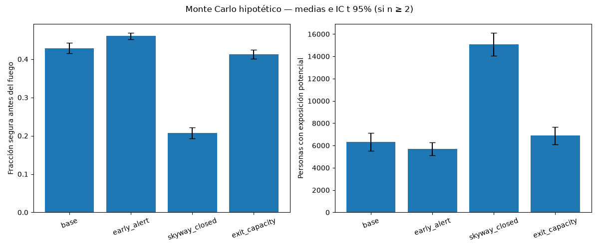
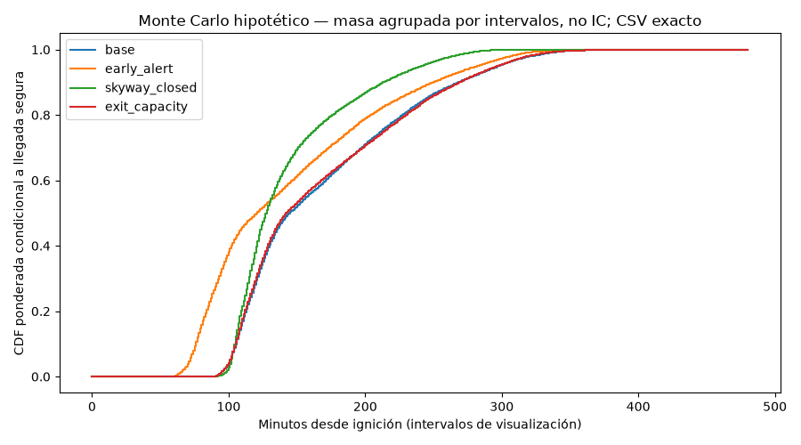
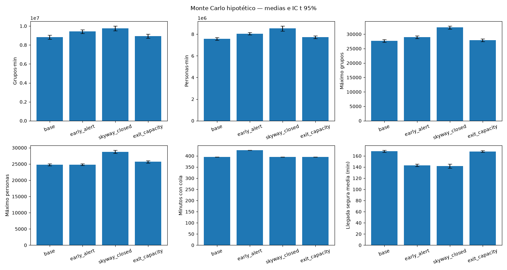

# Evacuación reproducible y comparación de escenarios

`scripts/evacuacion/experimentos.py` integra la población residencial, las réplicas de fuego y la red vial dirigida con el motor por eventos existente. Exporta métricas por réplica, intervalos de confianza y gráficas sin descargar datos. **La Parte 2 está completa en implementación y experimentos comparativos: terminaron las 120 corridas reales (30 por escenario) con cuatro procesos.** Los parámetros de respuesta son hipotéticos y reemplazables: los resultados no constituyen reconstrucción histórica, predicción de seguridad ni mortalidad. La calibración histórica del fuego **no valida la evacuación**. Este documento aporta solución, arquitectura, métodos, resultados y conclusiones para que la Parte 3 los integre al informe; el PDF, registro de IA, diapositivas y video siguen pendientes.

## Ejecución desde la raíz

Para reproducir, primero medir dos trabajos reales con dos procesos; luego comparar las 120 corridas. La producción ya completada está en `salidas/evacuacion_final`: **no sobrescribirla**, ni los parciales anteriores. Las órdenes siguientes usan directorios nuevos o vacíos; elegir otros nombres si ya existen:

```sh
PYTHONDONTWRITEBYTECODE=1 MPLCONFIGDIR="$PWD/.cache/matplotlib" OPENBLAS_NUM_THREADS=1 OMP_NUM_THREADS=1 .venv/bin/python scripts/evacuacion/experimentos.py --smoke --replicas 2 --scenario base --workers 2 --output salidas/evacuacion_smoke_parallel2_reproduccion
# Solo tras medir RAM/rendimiento y verificar equivalencia:
PYTHONDONTWRITEBYTECODE=1 MPLCONFIGDIR="$PWD/.cache/matplotlib" OPENBLAS_NUM_THREADS=1 OMP_NUM_THREADS=1 .venv/bin/python scripts/evacuacion/experimentos.py --replicas 30 --workers 2 --output salidas/evacuacion_reproduccion
```

Para comprobar los cuatro escenarios con una réplica: `--smoke --replicas 1`, sin `--scenario`. El programa imprime con `flush` las fases `preflight start/done`, `simulate start/done` (fin con tiempo de pared antes de distribución/exportación), `distribution done`, `example done`, `plots start/done` y `experiment complete`. Durante la simulación, el callback opcional `simulate(..., progress=callable)` informa tiempo modelado, horizonte, lotes procesados y personas seguras/restantes al inicio, cada ≥30 minutos modelados y al horizonte. El runner añade tiempo de pared solo a stdout; con `--workers >1` lanza procesos `spawn`. Los avisos de simulación incluyen PID/escenario/réplica y pueden intercalarse; el padre anuncia `workers start/done`. Un lote costoso puede demorar el siguiente aviso: estos mensajes prueban avance observado, no garantizan un latido cada cierto segundo. Una interrupción puede dejar resultados parciales: no reutilizar ese directorio como corrida final. La existencia de `summary.json` por sí sola no garantiza que todas las figuras hayan terminado: comprobar también el código de salida.

| Opción | Predeterminado / significado |
|---|---|
| `--network` | `data/procesado/red_vial.json`, contrato público de `build_network` |
| `--grid` | `data/procesado/grilla_fuego.npz`, campo `poblacion` |
| `--fire` | `salidas/fuego/llegada_replicas.npz`, `llegada_min` y `semillas` |
| `--contract` | `salidas/fuego/contrato.json`, forma, transformación, CRS y horizonte |
| `--config` | `config/escenarios_evacuacion.json`, todos los supuestos reemplazables |
| `--output` | `salidas/evacuacion`, directorio nuevo o vacío |
| `--replicas` | 30 por escenario; no puede exceder las réplicas de fuego disponibles |
| `--workers` | Entero 1..4, predeterminado 1 (secuencial); bool/fraccionarios inválidos también en API |
| `--smoke` | Permite menos de 30; **siempre** etiqueta salidas como provisionales, incluso con 30 |
| `--scenario` | `base`, `early_alert`, `skyway_closed` o `exit_capacity`; sin opción corre los cuatro |
| `--help` | Ayuda completa, sin leer datos ni crear salidas |

Las rutas predeterminadas son relativas a la raíz del proyecto, independientemente del directorio actual. Las rutas explícitas son relativas al directorio actual. El preflight valida archivos completos, forma, masa, fuego, semillas únicas, parámetros, geometría y contrato vial antes de crear el directorio de salida. Una entrada rechazada no crea archivos ni incrementa contadores. El adaptador no descarga, recorta ni muestrea población.

## Solución: población y fuego sin pérdida de masa

1. Convertir `poblacion` a float64 y sumar con `math.fsum`. Cada celda positiva produce grupos de hasta 3 personas ponderadas y un grupo adicional por **todo resto positivo**, incluso minúsculo. Se conserva `origin_cell`; no se fuerza un censo entero.
2. Transformar centros de celda con los seis coeficientes GDAL, incluida rotación. Asignar el nodo euclídeo más cercano con `scipy.spatial.cKDTree`, desempate por distancia y luego identificador lexicográfico. Conservar todos los nodos y componentes: ninguna población desconectada se elimina.
3. Invertir `contract.transform_gdal` para agregar `node.cell` a **cada** nodo y copiar la transformación a `metadata.transform_gdal`. Se usa `floor` y se sujeta un nodo exactamente sobre el límite exterior a la celda interior adyacente. La tolerancia de inversión es 1e-8 celdas, no un permiso para admitir nodos externos. En líneas interiores corresponde la celda determinada por `floor`; las aristas conservan sus celdas conservadoras del constructor vial.
4. Generar preparación con un RNG local NumPy `default_rng`/PCG64. `preparation_min ~ gamma(shape=2, scale=10 min)`; alerta base uniforme a 85 min desde las 06:25. Los grupos conservan `alert_min`, `preparation_min` y `ready_min = alert_min + preparation_min` por separado.
5. La réplica `r` toma directamente `llegada_min[r]`, su `semillas[r]` y preparación `2000+r`. Nunca usa la mediana ni repite un índice de fuego dentro de un escenario. Comparte grupos, preparación y fuego entre escenarios; no reinicia un generador global.

**Limitaciones explícitas:** la población representa residencia estimada, no presencia durante el incendio; la gamma solo expresa preparación positiva/asimétrica, sin ajuste histórico. El salto celda–nodo es instantáneo: no consume tiempo ni modela exposición durante el acceso, aunque el motor sí comprueba fuego en el origen antes de salir. Un resto fraccionario consume una plaza vial completa. La discretización no equivale a hogares observados. Alertas zonales, cierres históricos y refugios reales siguen pendientes de Parte 3.

`attachment` informa masa original y de grupos, cantidad de grupos/celdas positivas, número de celdas de origen sin salida (`no_exit_origins`), personas y fracción sin salida, nodos sin salida y distancias de acceso mínima/máxima/media/p50/p90 por origen, además de media ponderada por personas. La conectividad se calcula por alcanzabilidad dirigida inversa hacia destinos seguros, antes de cierres, fuego y agotamiento de capacidad; no se confunde fracción de nodos con fracción poblacional.

## Escenarios de un solo factor

| Escenario | Único cambio respecto de base |
|---|---|
| `base` | Ninguno: **todas** las salidas seguras reciben 5000 personas de capacidad, sustituyendo los 100000 genéricos del grafo |
| `early_alert` | Alerta 30 min antes, a 55 min; idéntica preparación |
| `skyway_closed` | Cierre desde t=0 de todas las aristas con la palabra completa Skyway en su nombre, ambas direcciones |
| `exit_capacity` | Una sola salida pasa de 5000 a 10000 personas; las restantes quedan en 5000 |

`capacity_target_node: null` elige el identificador de salida segura lexicográficamente menor; se puede reemplazar por un nodo explícito válido. El nodo objetivo, número de aristas Skyway y cantidad efectivamente cerrada se registran en cada corrida. No cambian capacidades viales, velocidades, grupos ni fuego entre escenarios. La selección por nombre no cierra Clark/Pentz/Neal incidentalmente. No se inventa contraflujo. Los valores y la justificación/advertencias están en el JSON de configuración, no ocultos en datos supuestamente históricos.

## Arquitectura y API

El integrador importa únicamente `motor.simulate` como contrato público del motor. Lee el JSON generado por `red_vial.build_network` sin alterar ese constructor ni duplicar enrutamiento, colas, reservas, cierres o exposición. El motor valida la red durante el preflight mediante una llamada pública sin grupos, sin fuego observado y horizonte cero. Las corridas usan `simulate(..., retain_details=False)` sin opción CLI nueva: solo limita la retención de detalles, no la simulación. La API del motor conserva el modo completo por defecto.

| Callable | Resultado / responsabilidad |
|---|---|
| `prepare_network(network, contract)` | Copia completa con celdas de nodos y transformación |
| `make_groups(population, network, contract, config, seed)` | `(groups, attachment)`; pesos, preparación y asignación deterministas |
| `scenario_inputs(network, groups, config, scenario)` | `(network_copy, groups_copy, closed_edges, intervention)` |
| `load_inputs(paths, replicas, smoke)` | Preflight sin escrituras; retorna entradas, resumen de acceso y hashes |
| `evacuation_statistics(arrivals)` | Media y percentiles ponderados, conteo de grupos y masa segura |
| `queue_duration(history)` | Compatibilidad con historias públicas completas anteriores; nunca integrar muestras compactas |
| `confidence_interval(values)` | `{n, mean, ci95}`; excluye `None`; IC nulo cuando n<2 |
| `summarize_replica(result)` | Métricas compactas y comprobaciones de invariantes del motor |
| `run_experiments(paths, replicas=30, smoke=False, scenarios=None, workers=1)` | Ejecuta secuencialmente o con spawn acotado; el padre escribe productos y retorna resumen |
| `main(argv=None)` | CLI; entradas inválidas terminan con código no cero |

Con `workers>1`, `ProcessPoolExecutor` usa explícitamente `multiprocessing.get_context('spawn')`, funciones de módulo e inicializador: cada hijo recibe una vez red/población/fuego/configuración/contrato validados, sin releer JSON por trabajo. Cada tarea contiene solo `(r, scenario)`; comparte el mismo cuerpo de simulación que workers=1, sin duplicar motor ni métricas. Regenera grupos con RNG local PCG64 `2000+r` (inicio configurable) y usa directamente fuego `[r]`: el proceso y el orden de tareas no participan de la semilla. La preparación es idéntica entre escenarios del mismo índice.

Solo el padre escribe cualquier CSV/JSON/figura. Valida masa, invariantes, cotas y estadísticas antes de aceptar cada entrega, que contiene escalares, llegadas ponderadas exactas y un único ejemplo acotado para el primer trabajo lógico; nunca estados/mapas/historias completos por tarea. El planificador conserva como máximo `2*workers` futuros y persiste en orden r externo/escenario interno. No usa `executor.map` con envío ilimitado. `metadata.worker_count` es la única procedencia variable; semillas, filas y estadísticas no dependen de la planificación.

Errores identifican escenario/r; se detiene el envío, se cancelan pendientes y se hace `shutdown(wait=True, cancel_futures=True)` también tras Ctrl-C. Los hijos ignoran SIGINT y el padre espera los trabajos ya activos (Python 3.12 no tiene terminación pública del executor): salir puede tardar, pero no abandona hijos. Un fallo de trabajo no publica resumen final ni figuras; conserva parciales para diagnóstico. Al importar la API con paralelismo, llamar desde un módulo importable bajo `if __name__ == '__main__':`, no desde REPL/notebook; el script ya tiene esa protección.

`paths` contiene las claves de ruta de la tabla CLI, incluido `output`. No se modifican las entradas. Véanse [motor_evacuacion.md](motor_evacuacion.md) y [red_vial.md](red_vial.md) para unidades e invariantes completos.

## Resultados y esquema de productos

| Producto | Contenido |
|---|---|
| `replicas.csv` | Una fila por escenario/réplica, semillas/índices, intervención, clasificación y métricas |
| `summary.json` | `metadata`, `scenarios[escenario][métrica] = {n, mean, ci95}` y `paired_differences_vs_base` |
| `distribution.csv` | Llegadas seguras exactas por escenario/réplica: tiempo, personas, masa acumulada y CDF condicional; no redondea pesos |
| `example_replica.json` | Primera corrida: ejemplo representativo acotado, métricas escalares exactas y conteos completos; **no** trayectoria completa |
| `cdf.png` | CDF ponderada de llegadas seguras agrupadas por masa de las réplicas, intervalos uniformes configurables (`distribution_bins=480`); el CSV conserva tiempos exactos |
| `metrics.png` | Fracción segura antes del fuego y exposición: media e IC t 95% |
| `queues.png` | Integrales, máximos y duración de colas, más tiempo medio de llegada segura: medias e IC t 95% |

El ejemplo usa `schema: evacuation_representative_example`, `version: 1`, `representative: true`, descripción y metadatos `run`. `metrics` conserva todas las métricas de la corrida completa. `result` conserva los escalares del motor (incluidos invariantes), pero solo los primeros 100 `groups` y `traversals`; `input_groups` contiene los primeros 100 grupos de entrada. `history` contiene como máximo 481 muestras: el primer evento real de cada franja de 1/480 del horizonte, más el horizonte, incluidos cero y horizonte sin duplicados. Son detalles representativos, no interpolación ni fuente de métricas. La proyección de un resultado público completo conserva el criterio anterior de índices uniformemente espaciados (`floor(i*(N-1)/(K-1))`).

`record_counts`, `exported_counts`, `truncated` y `selection` explicitan para cada colección su tamaño original exacto, exportado, truncamiento y criterio. En modo compacto los conteos de historia y travesías provienen de contadores de todos los lotes/inicios, no de la longitud retenida. `evacuation_times`, `edge_max_occupancy` y `destination_people` se omiten completamente del ejemplo: solo sus conteos y los totales/invariantes escalares permanecen. Las llegadas exactas siguen en `distribution.csv`. Ningún muestreo ilustrativo altera población, dinámica, estadísticas o productos exactos; la cantidad exportada no crece con eventos, grupos, tramos o travesías.

Métricas por réplica:

- `people_total`, `people_safe`, `people_safe_before_fire`, `people_exposed`, `people_temporary`, `people_remaining`: personas ponderadas. Exposición es un subconjunto transversal, no una categoría adicional de conservación.
- `fraction_safe_before_fire`: denominador toda la masa inicial, incluidos orígenes desconectados.
- `queue_group_minutes`, `queue_person_minutes`: integrales del motor (grupos·min y personas·min), no suma de eventos. `max_queue_groups`, `max_queue_people`: máximos simultáneos. `queue_duration_min`: integral exacta en línea del indicador de cola no vacía antes de cada lote real; incluye espera sin ruta y excluye preparación/tránsito. `summarize_replica` usa este escalar autoritativo, nunca la historia ilustrativa; solo acepta historia completa como compatibilidad para resultados antiguos sin el escalar.
- `evacuation_mean_min`, `evacuation_p50_min`, `evacuation_p90_min`: distribución ponderada **condicional a llegadas seguras**, minutos desde ignición. Percentil por inversa de CDF discreta (primer tiempo con peso acumulado suficiente). `safe_arrival_count` cuenta grupos y `safe_arrival_people` su masa. Sin llegadas, los tres tiempos son `null`, nunca cero.

Cada IC usa estadísticas de réplicas independientes, error estándar muestral y cuantil Student-t bilateral 95% con n−1 grados de libertad. No se tratan hogares como réplicas independientes. Las diferencias pareadas se calculan alternativa menos base, por el mismo índice de fuego/preparación; valores nulos se excluyen por pareja. Se informa n efectivo por métrica. Una sola réplica tiene media pero no IC. El IC no se recorta artificialmente a [0,1]. La CDF agrupada pondera personas seguras, no sustituye el promedio por réplica ni su IC.

`metadata` guarda SHA256 de los cinco archivos de entrada, configuración completa y supuestos, contrato, versiones/RNG, semillas por corrida, clasificación provisional, unidades, método estadístico e información de acceso. JSON se escribe con `allow_nan=False`; no incluye NaN/Infinity. No se usan tiempos de ejecución en productos deterministas; se imprimen en stdout.

## Escala, evidencia y límites de resultados

El grafo disponible al integrar tiene 31670 nodos, 64098 aristas dirigidas, seis salidas y 18 componentes; 935 nodos no tienen salida. La grilla es 205×278 con 40542 celdas positivas; el archivo contiene 30 fuegos con semillas 1000–1029. La producción conserva **50314 grupos y 42388.94983696542 personas ponderadas** según `metadata.attachment` del resumen. En 3700 celdas de origen, 94.98908536263116 personas (0.224089 %) no tienen salida topológica antes del fuego: permanecen en los denominadores.

Se retiene una salida compacta del motor por proceso activo y un solo ejemplo representativo acotado en disco. Spawn copia entradas y memoria de simulación por hijo; el padre retiene entradas y hasta `2*N` entregas acotadas por sus llegadas exactas, no por todos los eventos. Medir primero dos procesos: no inferir que 15 núcleos o 24 GiB permiten cuatro. N tiene límite fijo 4, sin selección automática. `OPENBLAS_NUM_THREADS=1 OMP_NUM_THREADS=1` en la orden evita sobresuscripción numérica; no hay dependencias nuevas ni cambios globales del entorno. Las llegadas exactas se transmiten a CSV por réplica; entre corridas solo quedan estadísticas escalares y histogramas gráficos acotados. Dentro de una corrida se retienen hasta 481 muestras de historia, primeras 100 travesías y registros activos hasta terminar, sin colecciones ocultas de detalles completados. Se conservan todos los estados finales, llegadas ponderadas y mapas de máximos/destinos. Los invariantes cubren **cada** travesía real, no solo la muestra. `metadata.detail_recording` documenta estos límites de registro; no describe cambios del modelo. El CSV de distribución puede ser grande; el ejemplo no exporta historias ni trayectorias completas. Ninguno es necesario para volver a calcular las medias/IC desde `replicas.csv`. La CDF gráfica agrupa tiempos en intervalos, pero conserva pesos; esto es una resolución visual, no muestreo ni aproximación de la simulación.

El motor cachea rutas multifuente, pero las reservas, cierres y cambios de destinos factibles pueden invalidar cachés. La medición del lote terminado se presenta abajo; no garantiza tiempo/memoria en otro equipo ni configuración. No sustituir población por una muestra para esconder un problema de rendimiento. Si la prueba real es lenta, registrar el tiempo y evaluar el motor en una unidad separada, sin cambiar silenciosamente semántica.

## Comprobación geográfica preliminar

La prueba `--smoke --replicas 1 --scenario base` con exportación acotada terminó con código 0 y `REAL_SMOKE_CHECK_PASS`. Se conservaron **42388,94983696542 personas ponderadas** en **50314 grupos**, sin violaciones de capacidad ni tránsito por vías cerradas; se generaron las tres figuras. De esa población, 94,98908536263116 personas (0,224089 %) quedan asignadas a componentes sin salida antes de considerar el fuego. No se eliminaron de los denominadores.

La corrida anterior, con retención completa dentro del motor, tardó 434,51 s (aproximadamente 7 min 15 s); la simulación consumió 419,67 s. `/usr/bin/time -l` registró 7795638272 bytes de RSS máximo y 13745613048 bytes de huella máxima de memoria en macOS. El ejemplo representativo ocupó 214095 bytes y todos los productos de esta prueba, 1684830 bytes. La exportación anterior sin límites se interrumpió por crecimiento excesivo; el archivo parcial de 9,84 GB se eliminó con autorización. Las métricas de la nueva corrida coinciden con la fila provisional anterior.

El benchmark compacto en `salidas/evacuacion_smoke_compact` terminó con código 0, según la verificación del orquestador: 377,38 s de pared, 371,73 s de simulación y 1229602816 bytes de RSS máximo (~1,23 GB). Todos los campos de `replicas.csv` y las estadísticas de escenarios/diferencias pareadas coincidieron exactamente con el modo completo; `distribution.csv` fue idéntico byte por byte. Se procesaron 22827498 travesías y 19154363 lotes de eventos. Es evidencia secuencial de una réplica. Después, dos réplicas base reales con dos procesos terminaron con código 0 y `PARALLEL2_REAL_EQUIVALENCE_AND_MASS_PASS`: 582,12 s de pared (413,192 s y 573,537 s de simulación por trabajo). La primera conservó exactamente todos los campos CSV y filas de distribución de la referencia; ambas aprobaron semillas, conservación, cotas y figuras. El RSS máximo reportado fue 2180825088 bytes; no mide la suma de memoria de todos los procesos. Se eligieron cuatro procesos con presupuesto conservador de cuatro veces ese máximo más padre y reserva, sobre 24 GiB de RAM. La suite de 63 pruebas y la verificación independiente de concurrencia y entorno aprobaron sin bloqueos.

Estas pruebas preliminares verificaron equivalencia, no efectos Monte Carlo. El primer lote secuencial se detuvo por tiempo y conserva parciales en `salidas/evacuacion`: no borrarlos, sobrescribirlos ni mezclarlos con resultados. **La producción posterior sí terminó** en `salidas/evacuacion_final`, como se documenta a continuación. Para otra ejecución usar un directorio nuevo.

## Producción completada: resultados para el informe (S2.7 y S2.9)

### Diseño y evidencia reproducible

La corrida final contiene **120 simulaciones: 30 por cada uno de cuatro escenarios**, horizonte de **480 min desde las 06:25**. Cada escenario usa 30 fuegos distintos (índices 0–29, semillas **1000–1029**) y preparación **2000–2029**, pareadas por índice entre escenarios. Se mantiene toda la población; no hay submuestreo. `provisional: false` significa lote completo, **no validación histórica**; su clasificación es `hypothetical_mc`. Los supuestos efectivos están en `metadata.config` de [summary.json](../salidas/evacuacion_final/summary.json) y en [la configuración](../config/escenarios_evacuacion.json).

Productos compactos versionados: [replicas.csv](../salidas/evacuacion_final/replicas.csv), [summary.json](../salidas/evacuacion_final/summary.json), [metrics.png](../salidas/evacuacion_final/metrics.png), [cdf.png](../salidas/evacuacion_final/cdf.png) y [queues.png](../salidas/evacuacion_final/queues.png). El CSV contiene las 120 filas para recalcular estadísticas; el JSON conserva hashes, semillas, supuestos y diferencias pareadas. `distribution.csv` (~156 MB) y `example_replica.json` (~200 KB) son productos **regenerables e ignorados por Git**, no archivos persistentes versionados: reproducirlos si se necesita la distribución exacta o el ejemplo.

Según el registro de ejecución del orquestador, el trabajo 11 terminó con código 0 y **`FULL_PARALLEL_120_REPLICA_CHECK_PASS`**: orden canónico, 120 filas, 30 fuegos distintos por escenario y semillas pareadas, metadatos no provisionales/cuatro workers, conservación, cotas de exposición, IC finitos/ordenados, tres comparaciones pareadas, tres figuras y límites/invariantes del ejemplo aprobados. La comprobación completa incluyó distribución exacta, capacidades y cierres. Además, el orquestador recomputó desde las 120 filas CSV todas las medias e IC Student-t 95% por escenario y pareados, confirmó los cinco SHA256 de entrada y comprobó por streaming 1686400 llegadas exactas en 120 grupos escenario/réplica (pesos positivos, orden temporal, CDF, masa y conteos). Revisó visualmente las tres figuras: legibles, unidades correctas y CDF condicional. Todo aprobó. Esta evidencia de ejecución y revisión de artefactos es distinta de las pruebas sintéticas y de la validación histórica.

Tiempo observado: **17849.23 s de pared (4 h 57 min 29 s)**, 69799.91 s de usuario y 167.65 s de sistema. `/usr/bin/time -l` informó **5048844288 bytes de RSS máximo**; **no es la suma del RSS del padre y todos los hijos ni una medición de la huella conjunta**. Para admitir cuatro workers en 24 GiB se presupuestaron conservadoramente `4 × 2180825088 = 8723300352 bytes` (~8.72 GB), más padre y reserva, a partir del ensayo de dos procesos; no se afirmó haber medido ese agregado. El benchmark compacto secuencial (~1.23 GB) y la igualdad exacta completo/compacto, seguida de la igualdad de la réplica real r0 en paralelo, sustentan la optimización sin cambiar métricas. En otro equipo hay que volver a medir antes de usar cuatro workers; dos también están soportados.

### Resultados por escenario

Cada celda muestra **media [IC 95%]**, redondeada desde el JSON, con **n=30** en todas las métricas mostradas. Los IC Student-t cuantifican variación entre réplicas bajo supuestos fijos, no incertidumbre histórica de parámetros ni un rango de predicción individual. Los identificadores coinciden con el CSV.

| Escenario | Seguras antes del fuego (%) | Exposición potencial (personas ponderadas) |
|---|---:|---:|
| `base` | 42.8813 [41.4809, 44.2817] | 6325.65 [5526.43, 7124.87] |
| `early_alert` | 46.0613 [45.2492, 46.8733] | 5699.07 [5130.58, 6267.56] |
| `skyway_closed` | 20.7898 [19.3553, 22.2242] | 15084.47 [14061.88, 16107.07] |
| `exit_capacity` | 41.2706 [40.1442, 42.3970] | 6885.82 [6104.14, 7667.51] |

Los tiempos siguientes son minutos **desde la ignición**, no desde que sale el grupo. Se calcula cada estadístico ponderado por personas dentro de cada réplica y luego su media/IC entre réplicas. p50/p90 son promedios de percentiles por réplica, no percentiles de una única distribución agrupada. Todos están **condicionados a llegar a destino seguro**, incluidos quienes pudieron tener exposición previa.

| Escenario | Media de llegada (min) | p50 (min) | p90 (min) |
|---|---:|---:|---:|
| `base` | 168.22 [166.50, 169.94] | 144.66 [142.52, 146.80] | 267.81 [263.21, 272.41] |
| `early_alert` | 143.22 [141.28, 145.16] | 120.32 [118.06, 122.59] | 249.07 [243.78, 254.36] |
| `skyway_closed` | 141.84 [138.17, 145.51] | 126.99 [124.74, 129.24] | 209.75 [199.71, 219.79] |
| `exit_capacity` | 167.89 [166.48, 169.30] | 142.30 [140.87, 143.73] | 268.15 [263.45, 272.85] |

**Lectura de estados:** `people_safe` puede incluir llegadas con exposición potencial previa; `people_safe_before_fire` las excluye. La conservación es `safe + temporary + remaining = total`: exposición se superpone con esos estados y **no** se suma como otra categoría de masa. `remaining` significa no haber llegado a un destino al horizonte, **no fallecidos ni necesariamente atrapados**. `people_temporary=0` en las 120 corridas porque los destinos de producción son solo salidas hipotéticas del dominio; no demuestra ausencia histórica de refugios ni su eficacia. El motor distingue destinos temporales y seguros, pero aquí no se afirman refugios históricos.

### Colas: longitud, duración e integrales

Se reportan máximos simultáneos de la cola agregada del sistema (no longitud física en metros), promediados entre réplicas. `queue_duration_min` integra el tiempo con cola no vacía: **incluye espera sin ruta disponible**, no únicamente espera por capacidad en un cuello de botella singular; excluye preparación y tránsito. Adelantar la alerta también amplía la ventana posible de espera dentro del horizonte fijo, por lo que mayor duración no implica por sí sola peor evacuación.

| Escenario | Máximo (grupos) | Máximo (personas ponderadas) | Duración (min) |
|---|---:|---:|---:|
| `base` | 27670.70 [27196.26, 28145.14] | 24815.81 [24499.71, 25131.92] | 394.855 [394.819, 394.892] |
| `early_alert` | 28972.53 [28510.26, 29434.81] | 24790.04 [24524.09, 25055.99] | 424.780 [424.738, 424.822] |
| `skyway_closed` | 32318.90 [31779.10, 32858.70] | 28770.61 [28332.50, 29208.73] | 394.887 [394.862, 394.912] |
| `exit_capacity` | 27932.40 [27430.98, 28433.82] | 25693.95 [25349.14, 26038.76] | 394.855 [394.819, 394.892] |

| Escenario | Integral (grupos·min) | Integral (personas ponderadas·min) |
|---|---:|---:|
| `base` | 8818782.40 [8599989.37, 9037575.43] | 7566892.15 [7442874.68, 7690909.63] |
| `early_alert` | 9423236.61 [9226334.70, 9620138.53] | 8053524.09 [7959064.06, 8147984.12] |
| `skyway_closed` | 9755988.58 [9499942.98, 10012034.18] | 8526086.85 [8289598.73, 8762574.98] |
| `exit_capacity` | 8932486.57 [8713311.33, 9151661.81] | 7731286.59 [7602335.65, 7860237.54] |

### Efectos pareados e interpretación

**Alternativa menos base**, con los IC pareados almacenados en `paired_differences_vs_base` (no restando extremos de IC marginales). La fracción se expresa en **puntos porcentuales (pp), no porcentaje relativo**; n=30 parejas.

| Alternativa | Δ seguras antes del fuego (pp) | Δ exposición (personas ponderadas) |
|---|---:|---:|
| `early_alert` | +3.1800 [+2.4621, +3.8978] | −626.58 [−954.66, −298.51] |
| `skyway_closed` | −22.0915 [−22.4535, −21.7295] | +8758.82 [+7602.87, +9914.78] |
| `exit_capacity` | −1.6107 [−1.9987, −1.2226] | +560.17 [+405.98, +714.36] |

- **Alerta temprana:** bajo este modelo, adelantarla 30 min se asocia con ~3.18 pp más de llegadas seguras antes del fuego y menor exposición potencial.
- **Cierre de Skyway:** reduce esa fracción ~22.09 pp y aumenta exposición. Su media de llegada menor **no representa mejor evacuación**: se condiciona a un subconjunto seguro mucho menor (~8817 personas frente a ~18188 en base), no al total inicial.
- **Capacidad de una salida:** duplicar de 5000 a 10000 personas la capacidad del destino `n1` da ~1.61 pp menos, un resultado contraintuitivo. El enrutamiento voraz y las reservas son reglas del modelo, **pero no se aisló ni verificó el mecanismo que explica este efecto**. Requiere diagnóstico adicional antes de recomendar políticas: no demuestra que más capacidad sea siempre perjudicial ni autoriza cambiar parámetros para forzar una mejora.

**Conclusión para el informe:** la implementación permite comparar un factor a la vez con fuego y preparación pareados, población conservada y métricas reproducibles. La señal favorable de alerta temprana y la sensibilidad al cierre de Skyway se limitan a esta parametrización. La evidencia histórica de avisos, cierres y refugios, la calibración/validación de respuesta y el diagnóstico del efecto de capacidad siguen siendo necesarios para trasladar hallazgos a decisiones reales. La Parte 3 debe integrar estas secciones y figuras en sus entregables; completar los experimentos no completa todo el proyecto.

### Figuras de producción







## Verificación automatizada

```sh
PYTHONDONTWRITEBYTECODE=1 MPLCONFIGDIR="$PWD/.cache/matplotlib" .venv/bin/python -m unittest discover -s tests -p 'test_experimentos_evacuacion.py' -v
PYTHONDONTWRITEBYTECODE=1 MPLCONFIGDIR="$PWD/.cache/matplotlib" .venv/bin/python -m unittest discover -s tests -v
```

Las pruebas usan NPZ y grafos sintéticos pequeños, incluida CLI en directorios temporales aislados: masa/restos minúsculos, conectividad, celdas de borde/rotación y empates, alertas/preparación separadas, un solo factor, dos sentidos de Skyway, elección de una única salida, repetibilidad, semillas/fuegos distintos y pareados, Student-t, tiempos nulos, integrales de cola, invariantes del motor, rechazos sin escrituras, smoke, selección, esquema, distribución y figuras. La equivalencia pública con 120 trabajos **sintéticos** compara CSV/distribución/ejemplo byte por byte y resumen exacto normalizando solamente `metadata.worker_count`; comprueba orden y semillas. Incluye script spawn con un solo trabajo y dos workers, validación 0/5/no entero/bool sin salidas, error real de worker y unión de hijos. El planificador también se prueba con error/Ctrl-C simulado para comprobar límite, cancelación y shutdown. No se encontró un fallo post-preflight público fiable sin agregar flags de prueba o mutaciones dependientes de carreras; el fallo de proceso se prueba en la interfaz privada del planificador. Estas pruebas no ejecutan el lote geográfico. Cobertura de integración: S2.2 y S2.5–S2.9; S2.3–S2.4 se reutilizan del motor.

La suite actual de **63 pruebas** y la verificación independiente de código/concurrencia y entorno aprobaron sobre el candidato `d2a06aa`, sin cambios de código posteriores. Los conteos anteriores (por ejemplo, 53 pruebas) son referencias históricas, no la cobertura actual. Esta actualización es documental: no volvió a ejecutar la suite ni la verificación independiente.

**Límites de aplicación:** preparación, respuesta vial, capacidades y acceso instantáneo sin calibración histórica. Los experimentos están completos bajo esos supuestos, no históricamente validados; no habilitan recomendaciones operativas sin evidencia y diagnóstico adicionales.
