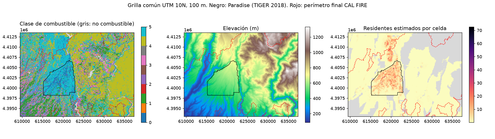
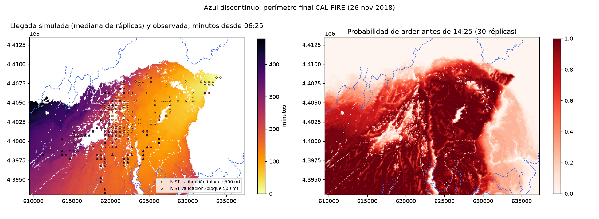
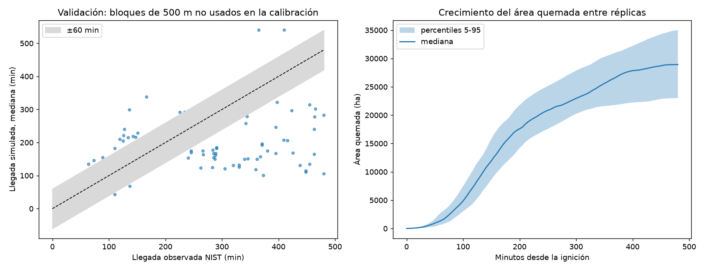
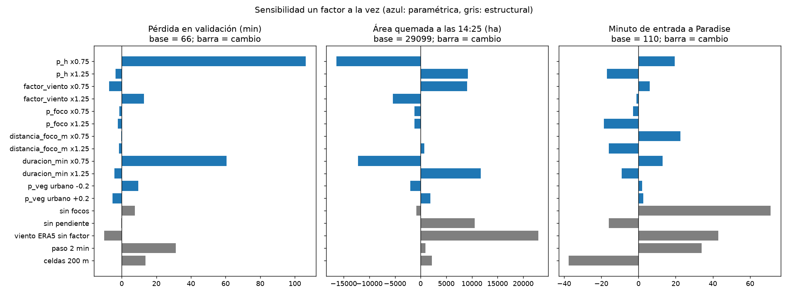

# Módulo de fuego: datos, modelo, calibración y validación

**Responsable:** frente 1 (datos reales y modelo del fuego).
**Estado:** módulo completo y reproducible. Exporta tiempos de llegada del fuego por réplica para el módulo de evacuación.
**Período simulado:** 8 de noviembre de 2018, de 06:25 a 14:25 hora local (480 min).
**Dominio:** 27,8 × 20,5 km en UTM 10N (EPSG:32610), celdas de 100 m (278 × 205). Cubre Pulga (origen), Concow, Paradise, Magalia y los cañones de Butte Creek y el río Feather. Definido en [config/dominio.json](../config/dominio.json).

## 1. Datos y preparación

| Capa | Fuente | Tratamiento | Script |
|---|---|---|---|
| Combustible | LANDFIRE 2016 FBFM40 (anterior al incendio) | Exportado a la grilla con vecino más cercano. Agrupado en las familias de Scott y Burgan (2005): GR, GS, SH, TU, TL, SB, más una clase urbana (código 91) | [f1](../scripts/fuego/f1_descargar_capas.py), [f2](../scripts/fuego/f2_preparar_grilla.py) |
| Elevación y pendiente | USGS 3DEP | Interpolación bilineal; pendiente por diferencias finitas | f1, f2 |
| Población | WorldPop 2018, 100 m | Reescalada para que Paradise sume 26 581 habitantes (BCAG/DOF, 1 ene 2018). Factor 1,451. Total del dominio: ~42 400 | f1, f2 |
| Perímetro final | CAL FIRE vía NIFC (153 336 acres, 26 nov 2018) | Máscara de celdas que ardieron en algún momento del incendio. Cubre 46 225 de 56 990 celdas | f1, f2 |
| Observaciones del fuego | NIST TN 2135, Appendix F | Limpieza documentada (§1.1) | [f3](../scripts/fuego/f3_observaciones_nist.py) |
| Viento | ERA5 por el archivo de Open-Meteo, punto 39,78 N, −121,55 O | Horario, interpolado a cada minuto y uniforme en el dominio | [f4](../scripts/fuego/f4_viento.py) |



### 1.1 Limpieza de las observaciones de NIST

1. **Año.** Las 2 839 filas dicen 2021. Se sustituye por 2018 conservando mes y día. Justificación: el registro `911-001-1` coincide en identificador y hora (06:25) con la primera llamada de 2018 en NIST TN 2252, tabla 10.
2. **Duplicados.** Las 15 hojas comparten filas. Se deduplica por (fuente, fecha, hora, latitud, longitud, tipo), lo que deja 2 236 observaciones únicas.
3. **Exclusiones:**
   - 288 con ventana de tiempo mayor a 60 min;
   - 177 de fuego residual;
   - 411 de tipo `O`, que son observaciones indirectas (brasas cayendo, resplandor);
   - 510 posteriores a las 14:25.

   El significado de los tipos se **infirió de las descripciones**: V vegetación, S foco adelantado, R estructura residencial, C estructura comercial. Hay que confirmarlo con el texto de TN 2135 en el informe.
4. **Resultado:** 848 observaciones en 527 celdas.
5. **Partición:**
   - bloques espaciales de 2 km, barajados con semilla 2018 y asignados al conjunto más pequeño;
   - calibración: 241 celdas (80 bloques de 500 m);
   - validación: 286 celdas (118 bloques de 500 m).

   Las celdas vecinas nunca quedan en conjuntos distintos.

**Viento ERA5:** del noreste (33–47°) a 4,9–6,0 m/s, con ráfagas de 15–17 m/s. La humedad relativa baja de 29 % a 9 %.

## 2. Modelo: autómata celular estocástico

Basado en Alexandridis et al. (2008). Cada celda está en uno de cuatro estados: no combustible, susceptible, ardiendo o consumida. En cada paso de 1 min, cada vecina ardiendo (vecindad de Moore) enciende a una celda susceptible con probabilidad

$$p = p_h\,(1+p_{veg})\,p_w\,p_s,\qquad p_w = e^{c_1 V}\,e^{V c_2(\cos\theta-1)},\qquad p_s = e^{a\,\theta_s}$$

donde:

- $V$ es el viento ERA5 multiplicado por un factor calibrable, porque ERA5 (~31 km) no resuelve el viento canalizado en los cañones;
- $\theta$ es el ángulo entre el viento y la dirección de propagación;
- $\theta_s$ es la pendiente, en grados, hacia la celda destino.

Una celda arde durante `duracion_min` y luego queda consumida.

**Focos adelantados (*spotting*).** NIST documenta que fueron decisivos en el avance sobre Paradise.

- Cada celda ardiendo emite una brasa con probabilidad `p_foco` por minuto.
- La brasa viaja a favor del viento una distancia lognormal, con mediana `distancia_foco_m · V/5` y σ = 0,8, y una dispersión angular de 15°.
- Al caer, enciende la celda destino con probabilidad `0,4·(1+p_veg)`.

Implementación: [modelo_fuego.py](../scripts/fuego/modelo_fuego.py), vectorizado con NumPy, ~0,5 s por réplica.

**Verificación:** [tests/test_modelo_fuego.py](../tests/test_modelo_fuego.py) tiene 7 pruebas sobre grillas sintéticas:

- reproducibilidad con semilla;
- ignición en el minuto 0;
- sin combustible no hay propagación;
- una barrera detiene el frente si no hay focos;
- el viento favorece el avance a sotavento;
- el fuego avanza más rápido cuesta arriba;
- los focos saltan barreras.

## 3. Calibración

Script: [f6_calibrar.py](../scripts/fuego/f6_calibrar.py). Se calibran seis parámetros en tres etapas:

1. 120 muestras por hipercubo latino (`p_h` y `p_foco` en escala logarítmica);
2. 60 refinamientos alrededor de los mejores candidatos;
3. confirmación de los 5 mejores con 10 réplicas y semillas nuevas.

El resto de los parámetros mantiene los valores de la literatura.

**Función objetivo.** Se probaron tres formulaciones. Las dos primeras fallaron, y sus fallos son un resultado del proyecto:

| Intento | Formulación | Problema observado |
|---|---|---|
| 1 | MAE por celda | Mínimo en ~89 min **quemando el 92 % del dominio**. Las observaciones dentro de Paradise se reparten durante horas, porque las estructuras se encienden mucho después del paso del frente, y el MAE premia predecir un promedio. |
| 2 | MAE + tope de área de 8 100 ha | La cifra de área de prensa resultó incompatible con la propia extensión de las observaciones NIST (23 × 15 km). Se descartó por falta de fuente confiable. |
| 3 (final) | Pérdida asimétrica por bloques de 500 m + comisión fuera del perímetro final | Detalle abajo. |

En la formulación final:

- La llegada observada de un bloque es su **primera** observación, que representa el frente.
- Como una observación es una cota superior, llegar tarde pesa 1 y llegar antes pesa 0,5.
- Se suman 120 min × la fracción del terreno *fuera* del perímetro final de CAL FIRE que el modelo quema. Ese terreno nunca ardió en 17 días.

**Parámetros calibrados** ([config/parametros_fuego.json](../config/parametros_fuego.json)):

| Parámetro | Valor | Lectura |
|---|---:|---|
| `p_h` | 0,178 | Probabilidad base por minuto entre vecinas |
| `factor_viento` | 2,63 | El viento efectivo es ~15 m/s, del orden de las ráfagas ERA5 |
| `p_foco` | 0,0084 por min | ~1 brasa cada 2 h por celda ardiendo |
| `distancia_foco_m` | 223 | Mediana ~600 m con el viento efectivo; la cola lognormal llega a varios km |
| `p_veg` urbano | −0,9 | Límite inferior del rango: la clase urbana casi no propaga por contacto |
| `duracion_min` | 5 | Límite inferior del rango |

Dos parámetros quedaron en el límite de su rango (`p_veg` urbano y `duracion_min`). Eso indica que el modelo los usa para frenar la propagación lateral, que es mayor a la real. Es una limitación estructural (§6).

## 4. Validación con datos no usados en la calibración

Script: [f7_validar_exportar.py](../scripts/fuego/f7_validar_exportar.py). 30 réplicas Monte Carlo, semillas 1000–1029. Intervalos de confianza del 95 % de la media entre réplicas. Los resultados completos están en [validacion.json](../salidas/fuego/validacion.json).

| Métrica (118 bloques de validación) | Autómata celular | Modelo radial (velocidad constante) | Piso de ruido de los datos |
|---|---:|---:|---:|
| Pérdida asimétrica (min) | **64,3** [62,7; 65,9] | 55,7 | 42,5 |
| MAE (min) | **105,1** [102,6; 107,6] | 108,2 | 59,7 |
| Sesgo (min) | −58,0 | — | — |
| Bloques dentro de ±60 min | 41,7 % | — | — |
| Bloques alcanzados antes de las 14:25 | 98,1 % | — | — |
| Área quemada a las 14:25 (ha) | 28 881 [27 657; 30 104] | 56 990 (todo el dominio) | — |
| Terreno fuera del perímetro final quemado | **11,9 %** | 100 % | — |

**Cómo leer la tabla:**

- **Piso de ruido:** el error que se comete al predecir cada bloque con la mediana de sus vecinos observados. Ningún modelo puede bajar mucho de ahí con estos datos.
- **Comparación con el radial:** en tiempos, el modelo radial es mejor en la pérdida y apenas peor en MAE. Pero quema un círculo completo: el 100 % del terreno que en realidad nunca ardió. El autómata reproduce la **forma** del incendio: avance hacia el suroeste con el viento, entrada a Paradise hacia los 110 min (NIST ubica las primeras igniciones en el borde este a las 07:49, ≈ 84 min) y comisión del 12 %. Su error en tiempos es del mismo orden que el del modelo radial.
- **Sesgo:** el sesgo negativo en validación (−58 min) es esperable, porque las observaciones son cotas superiores. Aun así, el modelo tiende a llegar antes en el sur del dominio (Foothills y Neal Rd), que el incendio real alcanzó entrada la tarde.




## 5. Sensibilidad

Script: [f8_sensibilidad.py](../scripts/fuego/f8_sensibilidad.py). Un factor a la vez, 10 réplicas por caso. Las cifras completas están en [sensibilidad.csv](../salidas/fuego/sensibilidad.csv).

| Caso | Pérdida validación | Área (ha) | Fuera de perímetro | Entrada a Paradise (min) |
|---|---:|---:|---:|---:|
| **Base** | 66,3 | 29 099 | 12 % | 110 |
| `p_h` ×0,75 | 172,7 | 12 678 | 5 % | 130 |
| `p_h` ×1,25 | 62,8 | 38 302 | 35 % | 93 |
| `duracion_min` ×0,75 | 126,9 | 16 907 | 6 % | 123 |
| `duracion_min` ×1,25 | 62,1 | 40 845 | 46 % | 101 |
| `factor_viento` ×0,75 | 59,1 | 38 160 | 36 % | 116 |
| `factor_viento` ×1,25 | 79,2 | 23 666 | 8 % | 109 |
| Sin focos | 74,0 | 28 254 | 12 % | **181** |
| Sin pendiente | 66,0 | 39 657 | 40 % | 94 |
| Viento ERA5 sin factor | 56,1 | 52 021 | **87 %** | 153 |
| Paso de 2 min | 97,5 | 30 013 | 15 % | 144 |
| Celdas de 200 m | 80,0 | 31 264 | 16 % | 72 |



**Hallazgos:**

1. **Los focos adelantados son indispensables para la cronología.** Sin ellos el fuego entra a Paradise 71 min más tarde, aunque el área total casi no cambia. Coincide con el papel que NIST atribuye al *spotting*.
2. **El modelo está cerca de un umbral de percolación** en `p_h` y `duracion_min`. Un cambio del 25 % pasa de un fuego que se apaga lateralmente a uno que quema casi todo el dominio. Es un comportamiento conocido de los autómatas probabilísticos, y significa que el área quemada tiene más incertidumbre que la dirección de avance.
3. **El viento más fuerte reduce el área.** Al aumentar el viento, el término $e^{Vc_2(\cos\theta-1)}$ estrecha el frente y frena los flancos. Usar ERA5 sin corregir da una pérdida baja, pero quema el 87 % del terreno que nunca ardió: es un ejemplo de que la métrica de tiempos sola no basta.
4. **Resolución numérica:** con paso de 2 min o celdas de 200 m, la entrada a Paradise se mueve de 72 a 144 min. Los parámetros están calibrados para 100 m y 1 min, y **no deben trasladarse a otra resolución sin recalibrar**.

## 6. Limitaciones

- El viento es uniforme en el espacio. No representa la canalización en los cañones del Feather River ni la variación en el tiempo de las ráfagas dentro de cada hora.
- El modelo no representa la propagación entre estructuras más allá de la clase urbana con un `p_veg` único. Las observaciones R/C tardías dentro de Paradise no se modelan.
- Las observaciones NIST no forman una muestra uniforme: se concentran donde había personas, en Paradise y a lo largo de las vías.
- `p_veg` por familia de combustible, `p_ignicion_foco` y `sigma_foco` se tomaron de la literatura o se fijaron sin calibrar.
- El significado de los códigos de tipo de NIST se infirió de las descripciones (§1.1).
- El modelo es retrospectivo y explicativo. No es una herramienta de predicción operativa.

## 7. Contrato con el módulo de evacuación

Archivos en [salidas/fuego/](../salidas/fuego/), descritos en [contrato.json](../salidas/fuego/contrato.json):

- **`llegada_replicas.npz`:** `llegada_min[réplica, fila, col]` es un `int16` con el minuto de ignición desde las 06:25; −1 si la celda no arde dentro del horizonte. Son 30 réplicas.
- **`llegada_mediana_min.tif`** y **`probabilidad_quema.tif`:** GeoTIFF en EPSG:32610 para mapas.
- **Peligro:** una celda está en peligro en el minuto *t* de la réplica *r* si `0 <= llegada_min[r, f, c] <= t`.
- **Coordenadas:** la fila 0 es el norte. El centro de una celda está en `x = 609500 + (col + 0.5)·100` e `y = 4413500 − (fila + 0.5)·100`.
- **Población:** está en `data/procesado/grilla_fuego.npz` (`poblacion`), sobre la misma grilla.

Para propagar la incertidumbre del fuego, la evacuación debe correr **cada réplica de evacuación sobre una réplica de fuego distinta**, en lugar de usar solo la mediana.

## 8. Reproducción

Desde la raíz del repositorio, en PowerShell:

```powershell
python -m venv .venv
.venv\Scripts\python -m pip install -r requirements-fuego.txt
.venv\Scripts\python scripts\fuego\f1_descargar_capas.py      # ~1 min, requiere internet
.venv\Scripts\python scripts\fuego\f2_preparar_grilla.py
.venv\Scripts\python scripts\fuego\f3_observaciones_nist.py   # requiere internet
.venv\Scripts\python scripts\fuego\f4_viento.py               # requiere internet
.venv\Scripts\python -m unittest discover -s tests -v
.venv\Scripts\python scripts\fuego\f6_calibrar.py             # ~5 min
.venv\Scripts\python scripts\fuego\f7_validar_exportar.py     # ~20 s
.venv\Scripts\python scripts\fuego\f8_sensibilidad.py         # ~2,5 min
```

Los datos crudos (`data/crudo/`) no se suben al repositorio. Las salidas procesadas sí, para que el módulo de evacuación pueda usarlas sin repetir las descargas.

## 9. Registro de uso de IA de este frente

Para la sección de prompts del informe. El módulo se desarrolló con un asistente de IA (Claude Code). Prompt principal: *"ayúdame a completar la persona 1, dámelo por fases"*.

- **Aciertos:**
  - propuso exportar todas las capas directamente a la grilla UTM desde los servicios ArcGIS, lo que evitó reproyecciones posteriores;
  - detectó la anomalía de año de NIST y su justificación;
  - implementó y probó el autómata.
- **Fallos detectados y corregidos durante el trabajo:**
  - la primera función objetivo (MAE por celda) llevó a una solución degenerada que quemaba casi todo el dominio;
  - el asistente propuso después un tope de área basado en una cifra de prensa recordada de memoria. Se descartó porque contradecía los propios datos y no tenía una fuente verificada;
  - la solución final (perímetro oficial y comparación por bloques) se adoptó después de analizar por qué fallaban las anteriores.
- **Verificación independiente pendiente para el equipo:**
  - confirmar los códigos de tipo en NIST TN 2135;
  - revisar que la hora de entrada a Paradise sea coherente con la cronología de [cronologia_base.md](cronologia_base.md);
  - comprobar la referencia de Alexandridis et al. (2008).

## Referencias

- Alexandridis, A., Vakalis, D., Siettos, C. I., & Bafas, G. V. (2008). A cellular automata model for forest fire spread prediction: The case of the wildfire that swept through Spetses Island in 1990. *Applied Mathematics and Computation, 204*(1), 191–201.
- Scott, J. H., & Burgan, R. E. (2005). *Standard fire behavior fuel models: a comprehensive set for use with Rothermel's surface fire spread model* (RMRS-GTR-153). USDA Forest Service.
- Maranghides, A., et al. (2021). *A Case Study of the Camp Fire — Fire Progression Timeline* (NIST TN 2135) y su Appendix F (datos).
- Maranghides, A., et al. (2023). *A Case Study of the Camp Fire — Notification, Evacuation, Traffic, and Temporary Refuge Areas* (NIST TN 2252).
- LANDFIRE (2016). *LF 2016 Remap, FBFM40*. USGS.
- U.S. Geological Survey. *3D Elevation Program (3DEP)*.
- WorldPop (2018). *Total population 100 m*.
- CAL FIRE / NIFC. *InterAgency Fire Perimeter History*, registro CAMP 2018.
- Hersbach, H., et al. (2020). The ERA5 global reanalysis. *Quarterly Journal of the Royal Meteorological Society, 146*, 1999–2049. Acceso vía Open-Meteo Historical Weather API.
