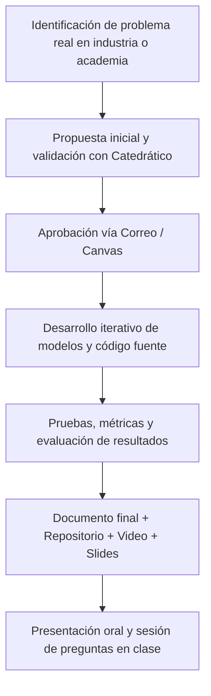
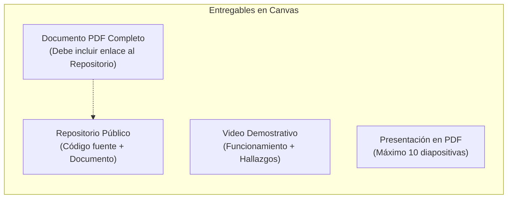

# Universidad del Valle de Guatemala
## Facultad de Ingeniería
### Modelación y Simulación
**Proyecto Final**

---

## 1. Instrucciones Generales

* **Modalidad y Grupos:** Actividad en grupos de **hasta 5 integrantes** (es permitido trabajar desde individual hasta un máximo de 5 personas).
* **Gestión en Canvas:** Es obligatorio unirse al grupo correspondiente en Canvas.
* **Integridad Académica:** No se permitirá ni se aceptará ningún indicio de copia. De presentarse cualquier caso, se procederá estrictamente según el reglamento institucional correspondiente.
* **Fechas límite:** La entrega estará habilitada hasta el día y hora indicados en Canvas. Se recomienda aprovechar el tiempo de clase para resolver dudas y avanzar progresivamente.

> ### ⚠️ Política sobre el uso de Inteligencia Artificial (IA)
> Se espera que los estudiantes utilicen herramientas de Inteligencia Artificial de forma **responsable, reflexiva y crítica**.
> 
> Como parte integral del reporte final, se debe incluir una sección detallada con el **historial de los prompts más relevantes** utilizados:
> - Explicar cuáles dieron resultados satisfactorios y cuáles presentaron fallas o no respondieron adecuadamente a lo solicitado.
> - Justificar por qué ocurrieron dichos aciertos o errores.
> - Argumentar la evaluación crítica hecha sobre las respuestas y detallar de qué manera la IA contribuyó al desarrollo de la solución.

---

## 2. Descripción y Alcance del Proyecto

Los estudiantes seleccionarán un tema de su interés vinculado a la **Modelación y Simulación**, ya sea profundizando en un concepto abordado durante las clases o explorando una temática nueva relacionada. 

A partir de este tema, deberán identificar un **problema real** y diseñar una solución computacional a través de técnicas de modelación y simulación.

### Proceso de Aprobación del Tema
1. **Sin temas repetidos:** Los temas se asignan estrictamente por orden de solicitud (*First-Come, First-Served*).
2. **Solicitud formal:** Debe enviarse la propuesta al profesor a la mayor brevedad posible.
3. **Entrega parcial en Canvas:** Deberán realizar una entrega previa en Canvas que contenga:
   - La descripción del proyecto propuesto.
   - Captura de pantalla del correo electrónico del catedrático donde confirme su aprobación formal.

---

## 3. Especificaciones Técnicas

* **Aplicación real:** El tema y problema deben poseer utilidad práctica demostrable en la industria o el ámbito académico.
* **Profundidad más allá de la IA:** Dado que se permite la IA, la complejidad del problema debe superar ampliamente lo que un simple prompt o consulta directa pueda generar por sí solo.
* **Proceso iterativo:** El trabajo final debe reflejar el ciclo iterativo de diseño, refinamiento, entendimiento y validación técnica de la solución.
* **Implementación:** Construir uno o varios programas ejecutables que pongan en práctica la teoría de modelación/simulación.
* **Verificación y validación:** Comprobar experimentalmente el correcto (o incorrecto) funcionamiento del sistema y respaldar los hallazgos con datos cuantitativos.

---

## 4. Estructura de la Documentación (Informe Escrito)

El informe final debe entregarse en formato **PDF** e incluir las siguientes secciones en orden lógico:

| Sección | Descripción y contenido requerido |
|---|---|
| **1. Descripción del problema** | Planteamiento del problema real, contexto y justificación de su relevancia. |
| **2. Análisis** | Estudio de variables, supuestos del modelo, condiciones iniciales y restricciones. |
| **3. Propuesta de solución** | Abordaje teórico y conceptual mediante técnicas de modelación y simulación. |
| **4. Descripción de la solución** | Arquitectura del software, diseño algorítmico y funcionamiento detallado de los programas. |
| **5. Herramientas aplicadas** | Detalle de tecnologías, librerías y frameworks.  • *Temas no vistos en clase:* Explicación teórica profunda. • *Uso de IA:* Registro de prompts utilizados, evolución de ideas y comprensión técnica generada. |
| **6. Resultados (métricas)** | Datos experimentales, tablas, gráficas, métricas cuantitativas y análisis de desempeño. |
| **7. Conclusiones** | Hallazgos principales, balance de objetivos e impacto de la simulación. |
| **8. Bibliografía** | Fuentes de información y literatura consultada bajo normas formales de citación. |

---

## 5. Entregables Obligatorios

1. **Documento principal (PDF):**
   - Informe formal con las 8 secciones especificadas.
   - Enlace visible hacia el **repositorio público** (GitHub, GitLab, etc.) que contenga todo el código fuente y el documento.
2. **Video demostrativo:**
   - Grabación que evidencie el funcionamiento real de la solución implementada.
   - Explicación de los hallazgos principales, metodología y conclusiones del proyecto.
3. **Presentación de diapositivas (PDF):**
   - Diapositivas utilizadas en la exposición (máximo 10 slides o su equivalente en infografía).

---

## 6. Presentación en Clase

* **Formato:** Exposición presencial en clase con ronda abierta de preguntas por parte de compañeros y catedrático.
* **Extensión:** Máximo **10 diapositivas** (o formato análogo como infografía).
* **Guía de contenido:** Sintetizar de forma creativa los puntos del informe escrito: problema, solución propuesta, modelo de simulación, herramientas, resultados numéricos y conclusiones.

---

## 7. Rúbrica de Evaluación

| Criterio | Puntos | Aspectos a evaluar |
|---|:---:|---|
| **1. Aprobación del tema** | 3 pts | Envío oportuno, entrega parcial en Canvas con la descripción y captura de correo de aprobación. |
| **2. Documento final** | 5 pts | Completitud de las secciones requeridas, calidad de redacción, profundidad técnica y sección de prompts/IA. |
| **3. Repositorio público** | 1 pt | Organización del código fuente, facilidad de reproducción y enlace funcional. |
| **4. Video explicativo** | 1 pt | Claridad en la demostración del software, explicación técnica y síntesis de hallazgos. |
| **5. Slides (Diapositivas)** | 5 pts | Diseño claro, síntesis de ideas, respeto del límite de 10 láminas y apoyo visual coherente. |
| **6. Presentación oral** | 10 pts | Dominio del tema, respuesta fluida a preguntas, manejo del tiempo y comunicación en clase. |
| **7. Calidad de la solución** | 5 pts | Nivel de aplicación de modelación/simulación, rigor de validación, métricas y relevancia del problema. |
| **TOTAL** | **30 pts** | **Calificación global del Proyecto Final** |